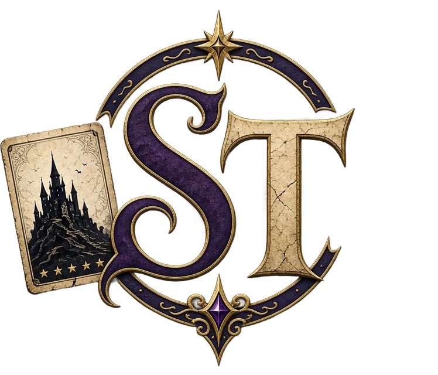
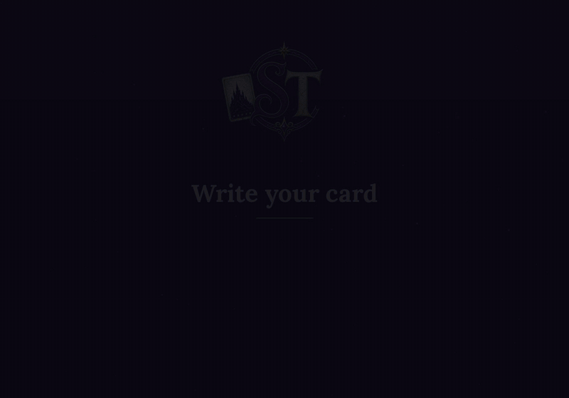

<p align="center"></p>
<p align="center"></p>

<p align="center">Make <a href="https://docs.sillytavern.app">SillyTavern</a> character cards in one place: the cover, the data, and the PNG with everything embedded.</p>

<p align="center"><a href="https://daddaiz.github.io/StCardCreator/"><b>Try it online</b></a> · <a href="https://github.com/Daddaiz/StCardCreator/releases/latest"><b>Download</b></a></p>

<p align="center"></p>

## Features

**Write**
- Every SillyTavern field on one page: description, personality, scenario, first and alternate greetings, dialogue examples, advanced definitions, lorebook, creator's metadata. Live token counts, automatic drafts, undo for every AI action.
- 🪄 **Wand** on each field: rewrites your text for that field, with optional questions first. *Needs an API.*
- **AI-assisted generation**: describe the idea in any language, pick the fields, get them written one by one in English. *Needs an API.*
- **Lorebook**: import a lorebook JSON, or let the AI suggest entries from the description with proper names and focused trigger keywords (optionally also in other languages, for chats not in English). *Needs an API.*
- **Consistency check**: finds contradictions, `{{char}}`/`{{user}}` misuse and leftover text, offers one-click undoable fixes, then gives the card a grade (S+ to C) in five categories. *Needs an API.*

**Design**
- Cover with image, name, tagline, fonts, frames, masks, and three palettes per color set taken from the image (with a shuffle button).
- Your own transparent PNG/WebP frames, saved in the browser.
- Thumbnail preview at 140, 100 and 64 px; the card flips to show a checklist of every field.
- **Edit your PNG**: decorate a ready image without writing data.

**Images**
- Ready-to-paste image prompts for the character and the first-message scene, in the style of your model (natural language, FLUX, SDXL/SD3, Pony or anime tags).
- **Image generation** from inside the app, with its own service: OpenAI (ChatGPT image models), OpenRouter, Nano-GPT, a local Stable Diffusion WebUI / Forge (started with `--api`), or a custom OpenAI-compatible server. *Needs an image API.* The exe can also download a small checkpoint for a local WebUI.

**Import and export**
- Import a card PNG or JSON. Export a PNG with the data embedded (`chara` + `ccv3`), JSON V3 or V2, CHARX (RisuAI) or TavernAI V1.
- **Cards**: a gallery of your saved cards, in the browser.
- A notice tells you when a newer release is out.

**SillyTavern**
- **Add to SillyTavern** and **SillyTavern cards** (list, edit, update, with a review of every changed field). *Windows exe only; SillyTavern must be running, with your login in the API page if it asks. Reload SillyTavern (F5) afterwards.*

Dark and light themes. The interface is in English; the AI writes the card text in English.

## Get it

- **Online**: [daddaiz.github.io/StCardCreator](https://daddaiz.github.io/StCardCreator/), nothing to install.
- **ST-Card-Creator.exe** (Windows, portable) and **ST-Card-Creator.html** (any browser, one file) on the [Releases](https://github.com/Daddaiz/StCardCreator/releases/latest) page.

> The exe is not code-signed: if Windows SmartScreen blocks it, click **More info**, then **Run anyway**. The online and HTML versions do the same thing.
>
> Made for a computer: the phone and tablet layout is not tested and does not work well.

## AI setup

AI features need an API, set in the **API** tab: OpenRouter, NanoGPT, OpenAI, Anthropic, or any OpenAI-compatible server (local ones too). The key stays in your browser and is saved only if you tick "Remember". Without an API you can still write, design and export cards.

<p align="center"></p>

## Build it yourself

```
npm install
npm run dist
```

## License

MIT, see [LICENSE](LICENSE).
