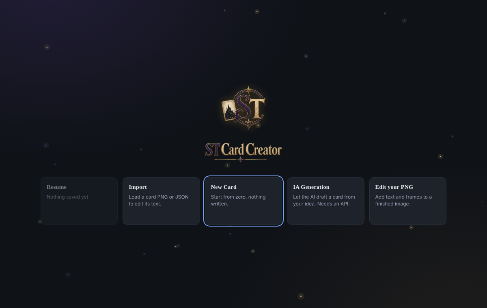
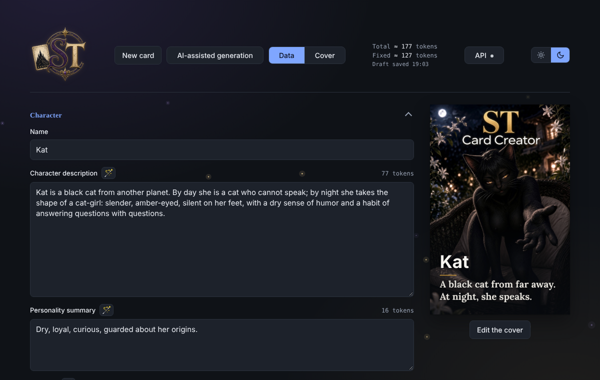
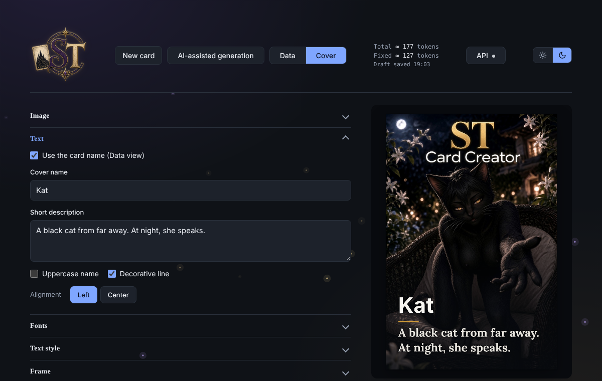
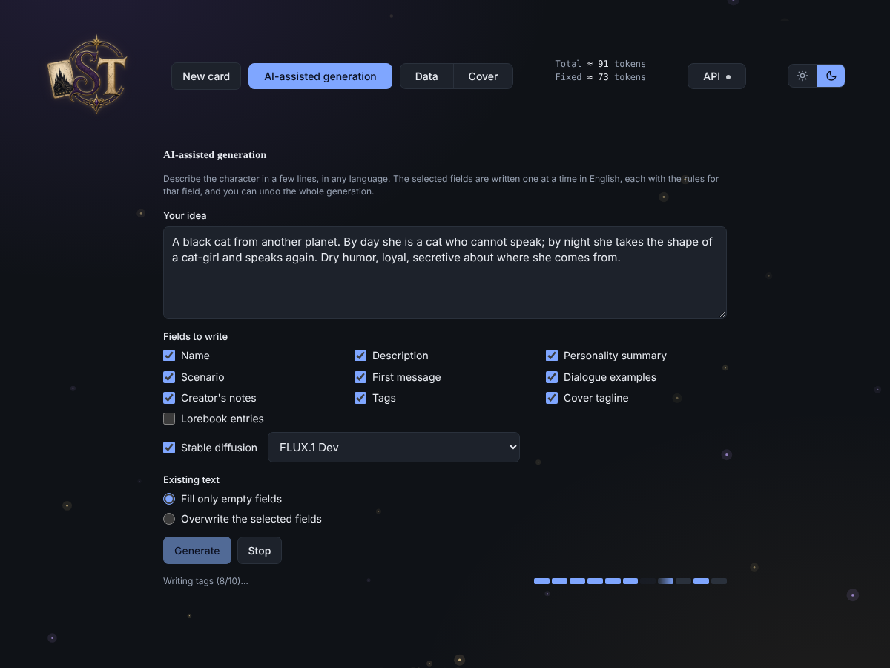
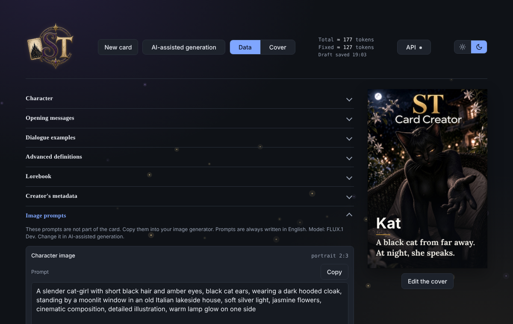

<p align="center"></p>

<p align="center">Make <a href="https://docs.sillytavern.app">SillyTavern</a> character cards in one place: the cover, the data, and the PNG with everything embedded.</p>

<p align="center"></p>

## Try it

**[Open it online](https://daddaiz.github.io/StCardCreator/)**: no download, runs in your browser.

## Download

Go to **Releases** and pick one:

- **ST-Card-Creator.exe** for Windows. Portable, no install.
- **ST-Card-Creator.html** for any browser. One file, nothing to install.

> **Windows warning:** the exe is not code-signed, so Windows SmartScreen may say it "prevented an unrecognized app from starting". Click **More info**, then **Run anyway**. If you prefer not to, use the online version or the HTML file: they do the same thing.

## What it does

### Write the card
Every SillyTavern field in one clean page: description, personality, scenario, opening messages, dialogue examples, advanced definitions, lorebook. Token counts update as you type, and a 🪄 wand next to each field can improve your text with AI. Drafts are saved automatically, and every AI action can be undone.

<p align="center"></p>

### Design the cover
Pick an image, add the name and a short line, choose fonts, frames and masks. Export a PNG with the card data embedded (`chara` and `ccv3`), or the JSON on its own. You can also import any existing card, or just decorate a ready image.

<p align="center"></p>

### Let the AI draft it
Write an idea in any language. Choose which fields to write, and watch the progress bar fill as each one is done. Everything comes out in English, field by field, with the right rules for each.

<p align="center"></p>

### Image prompts
Tick **Stable diffusion**, choose your image model, and get ready-to-paste prompts for the character and for the first message scene. They follow the style each model likes: natural language, FLUX, SDXL/SD3, Pony tags, anime tags. These prompts are not part of the card. When the image is ready, one click adds `` under the first message.

<p align="center"></p>

## AI setup

The AI features need an API, set in the **API** tab: OpenRouter, NanoGPT, OpenAI, Anthropic, or any OpenAI-compatible server (including local ones). Your key stays in your browser and is only saved if you tick "Remember". Without an API you can still write and export cards; only the wand and generation are off.

## Build it yourself

```
npm install
npm run dist
```
